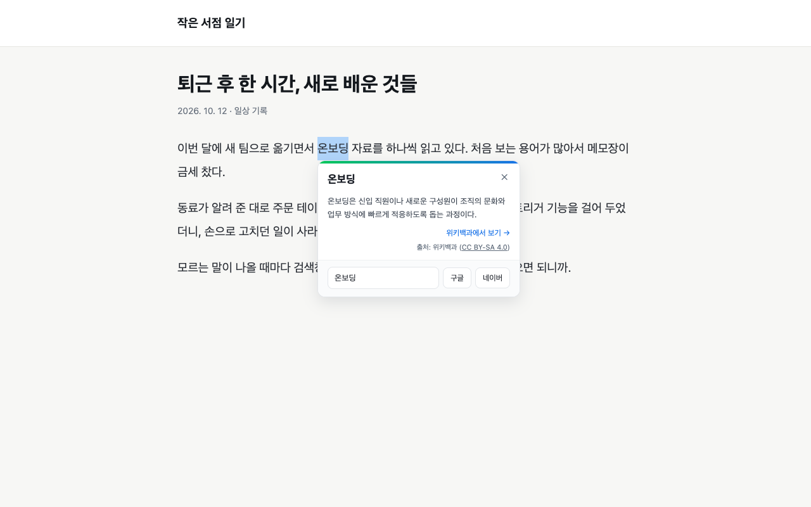
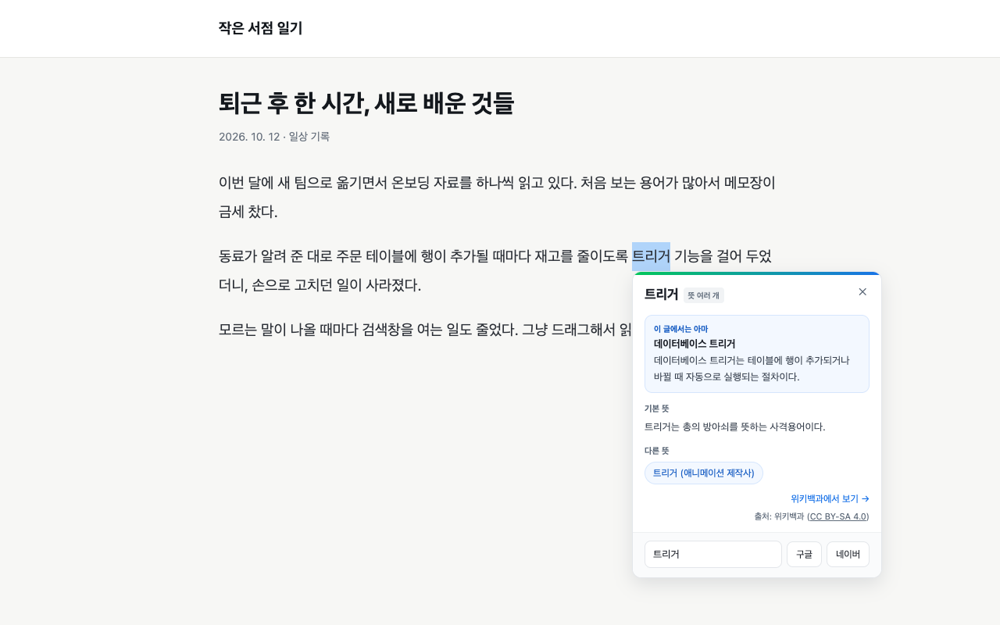
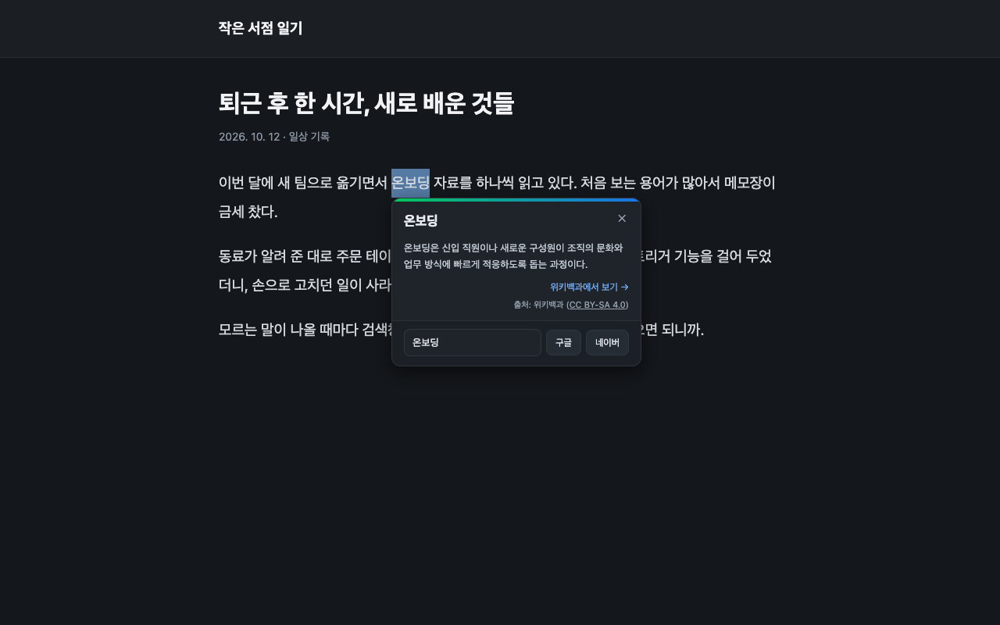

# Drag and Find

모르는 단어가 나오면 검색창을 열지 말고, 그냥 드래그하세요.

Drag and Find는 웹페이지에서 드래그한 단어의 한국어 위키백과 요약을 그 자리에 카드로 보여 주는 크롬 확장 프로그램입니다. 블로그나 기사를 읽다가 탭을 옮기지 않아도 돼서 읽던 흐름이 끊기지 않습니다.



## 설치

- **크롬 웹스토어**: [Drag and Find 설치하기](https://chromewebstore.google.com/detail/odakmhndhedojcgadjfaeeljddldicla)
- **직접 설치**: 아래 [개발](#개발) 부분을 참고해 빌드한 뒤 `chrome://extensions`에서 불러올 수 있습니다.

## 사용 방법

1. 웹페이지에서 궁금한 단어를 드래그합니다.
2. 단어 옆에 나타난 돋보기 아이콘을 누르거나, 단축키 `Alt+Shift+F`(맥은 `⌥⇧F`)를 누릅니다.
3. 위키백과 요약 카드가 단어 아래에 나타납니다. `Esc` 키나 카드 바깥을 누르면 닫힙니다.

## 주요 기능

- **위키백과 요약**: 한국어 위키백과의 첫 문단을 바로 보여 줍니다.
- **뜻이 여러 개인 단어**: 앞뒤 글을 보고 "이 글에서는 아마 이 뜻"을 먼저 골라 보여 주고, 기본 뜻과 다른 뜻도 함께 보여 줍니다. 다른 뜻을 누르면 그 뜻의 요약으로 바뀝니다.
- **구글·네이버 검색**: 위키백과에 없거나 더 찾아보고 싶을 때, 같은 단어로 검색한 새 탭을 엽니다. 카드의 검색어 칸에서 검색어를 고쳐 검색할 수 있고, `Enter`를 누르면 설정에서 고른 사이트(기본 네이버)로 검색합니다.
- **설정**: 드래그할 때 아이콘을 띄울지, 카드 테마(크롬 설정 따라가기 / 밝게 / 어둡게), `Enter`로 검색할 곳(네이버 / 구글)을 고를 수 있습니다.

| 뜻이 여러 개인 단어 | 어두운 테마 |
|---|---|
|  |  |

## 개인정보

- 자동으로 연결하는 곳은 한국어 위키백과뿐이며, 찾기를 요청했을 때만 선택한 단어를 보냅니다.
- 구글·네이버 버튼은 누를 때(또는 검색어 칸에서 `Enter`를 칠 때)만 동작합니다. 누르면 그 단어(또는 내가 고친 검색어)로 검색한 페이지가 새 탭으로 열리므로 그 말이 해당 사이트에 전달됩니다.
- 단어 앞뒤의 글은 뜻을 고르는 데에만 브라우저 안에서 쓰고, 어디에도 보내지 않습니다.
- 분석 도구, 광고, 자체 서버가 없습니다. 설정은 내 기기에만 저장됩니다.

자세한 내용은 [개인정보 처리방침](PRIVACY.md)을 확인하세요.

카드의 내용은 [위키백과](https://ko.wikipedia.org/)에서 가져오며, 출처와 라이선스(CC BY-SA 4.0)를 카드에 표시합니다.

## 개발

[WXT](https://wxt.dev/)와 TypeScript로 만들었습니다. Node 22와 pnpm 12가 필요합니다.

```bash
pnpm install
pnpm exec playwright install chromium   # E2E 테스트용, 처음 한 번
```

| 목적 | 명령 |
|---|---|
| 개발 (크롬 자동 실행, 변경 즉시 반영) | `pnpm dev` |
| 빌드 (`.output/chrome-mv3/`) | `pnpm build` |
| 단위 테스트 / E2E 테스트 | `pnpm test` / `pnpm test:e2e` |
| 타입 검사 / 린트 / 포맷 검사 | `pnpm compile` / `pnpm lint` / `pnpm format:check` |
| 웹스토어 업로드용 zip | `pnpm zip` |

크롬에 직접 올려 보기: `pnpm build` → `chrome://extensions` → 개발자 모드 켜기 → "압축해제된 확장 프로그램을 로드합니다" → `.output/chrome-mv3` 폴더 선택

## 문의

maestro001220@gmail.com
