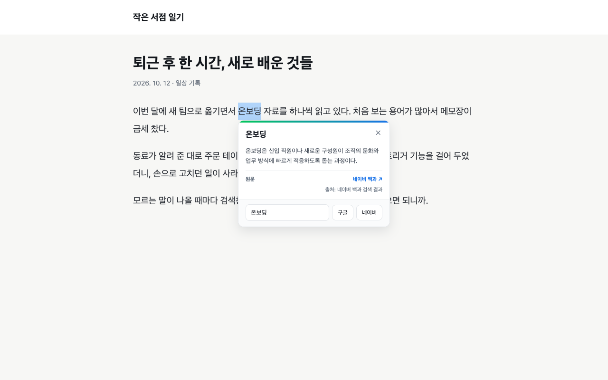
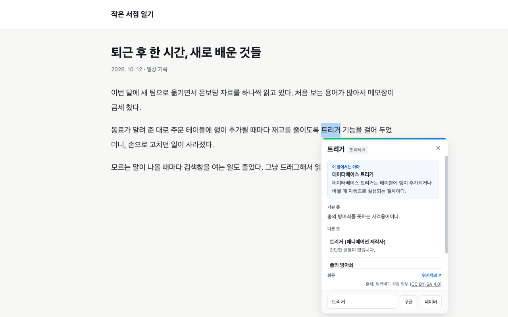
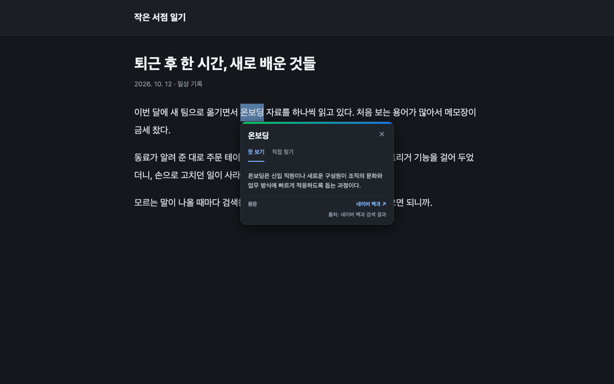

# Drag and Find

모르는 단어가 나오면 검색창을 열지 말고, 그냥 드래그하세요.

이 문서는 저장소의 최신 코드(1.0.2)를 설명합니다. 크롬 웹스토어의 공개 버전은 심사 상태에 따라 다를 수 있습니다.

Drag and Find는 웹페이지에서 드래그한 단어의 네이버 백과 검색 결과를 그 자리에 카드로 보여 주는 크롬 확장 프로그램입니다. 네이버 백과에 결과가 없거나 호출 한도를 넘으면 한국어 위키백과를 조회합니다.

Cloudflare Worker가 한도를 넘거나 연결되지 않을 때도 확장 프로그램이 위키백과를 직접 조회합니다.



## 설치

- **크롬 웹스토어**: [Drag and Find 설치하기](https://chromewebstore.google.com/detail/odakmhndhedojcgadjfaeeljddldicla)
- **직접 설치**: 아래 [개발](#개발) 부분을 참고해 빌드한 뒤 `chrome://extensions`에서 불러올 수 있습니다.

## 사용 방법

1. 웹페이지에서 궁금한 단어를 드래그합니다.
2. 단어 옆에 나타난 돋보기 아이콘을 누르거나, 단축키 `Alt+Shift+F`(맥은 `⌥⇧F`)를 누릅니다.
3. 출처가 표시된 설명 카드가 단어 아래에 나타납니다. `Esc` 키나 카드 바깥을 누르면 닫힙니다.

### 컴퓨터에 저장된 HTML 파일에서 사용하기

크롬은 기본적으로 확장 프로그램이 `file://` 주소로 연 로컬 파일에서 실행되는 것을 허용하지 않습니다. 로컬 HTML 파일에서 단어를 드래그해도 아이콘이 나타나지 않는다면 다음 설정을 켜세요.

1. 크롬 주소창에 `chrome://extensions`를 입력합니다.
2. **Drag and Find**의 **세부정보**를 엽니다.
3. **파일 URL에 대한 액세스 허용**을 켭니다.
4. 로컬 파일 탭을 새로고침한 뒤 다시 사용합니다.

이 설정은 크롬에서 연 `file://` 페이지에 확장 프로그램이 동작하도록 허용합니다. 컴퓨터의 다른 파일을 자동으로 열거나 서버로 보내지는 않으며, 찾기를 요청하면 선택한 단어만 조회에 사용합니다. 자세한 내용은 [크롬의 파일 URL 접근 안내](https://developer.chrome.com/docs/extensions/develop/concepts/declare-permissions?hl=ko#allow-access)를 참고하세요.

## 주요 기능

- **네이버 백과 우선 조회**: 네이버 백과 검색 결과 한 건을 보여 줍니다. 결과가 없거나 한도가 차면 위키백과 요약을 보여 줍니다.
- **Worker 장애 시 위키백과 전환**: 중계 서버가 응답하지 않거나 한도를 넘으면 확장 프로그램이 위키백과에서 직접 설명을 가져옵니다.
- **뜻이 여러 개인 단어**: 앞뒤 글을 보고 "이 글에서는 아마 이 뜻"을 먼저 골라 보여 주고, 기본 뜻과 다른 뜻도 함께 보여 줍니다. 다른 뜻을 누르면 상세 요약을 보고, `← 뜻 목록`으로 돌아올 수 있습니다.
- **직접 찾기**: 카드 헤더의 `직접 찾기` 탭에서 단어를 고쳐 입력하고 `Enter`나 `뜻 찾기` 버튼을 누르면 카드 안에 새 뜻이 표시됩니다.
- **구글·네이버 검색**: `직접 찾기` 탭에서 구글 또는 네이버를 누르면 입력한 단어로 검색한 새 탭이 열립니다.
- **설정**: 드래그할 때 아이콘을 띄울지와 카드 테마(크롬 설정 따라가기 / 밝게 / 어둡게)를 고를 수 있습니다.

| 뜻이 여러 개인 단어 | 어두운 테마 |
|---|---|
|  |  |

## 개인정보

- 찾기를 요청했을 때 선택한 단어를 Cloudflare Worker로 보냅니다. Worker는 네이버 백과를 우선 조회하고 필요할 때 위키백과를 조회합니다. Worker 요청이 실패하면 확장 프로그램이 선택한 단어를 위키백과로 직접 보냅니다.
- 직접 입력한 단어도 카드에서 뜻 찾기를 요청할 때 같은 Worker 조회 흐름에 사용합니다. 이때 웹페이지의 주변 문맥은 보내지 않습니다.
- 구글·네이버 링크는 직접 누를 때만 동작합니다. 입력한 검색어로 검색한 페이지가 새 탭으로 열리므로 그 말이 해당 사이트에 전달됩니다.
- 단어 앞뒤의 글은 뜻을 고르는 데에만 브라우저 안에서 쓰고, 서버로 보내지 않습니다.
- 분석 도구와 광고는 없습니다. 설정은 내 기기에만 저장됩니다. 검색 결과는 캐시하지 않습니다.

자세한 내용은 [개인정보 처리방침](PRIVACY.md)을 확인하세요.

카드에는 실제 출처와 원문 링크를 한 줄로 표시합니다. 위키백과 내용을 보여 줄 때는 CC BY-SA 4.0 표시도 붙입니다.

## 개발

[WXT](https://wxt.dev/)와 TypeScript로 만들었습니다. Node 22와 pnpm 12가 필요합니다.

```bash
WXT_LOOKUP_API_URL=https://drag-and-find-lookup.maestro001220.workers.dev pnpm install
pnpm exec playwright install chromium   # E2E 테스트용, 처음 한 번
```

| 목적 | 명령 |
|---|---|
| 개발 (크롬 자동 실행, 변경 즉시 반영) | `pnpm dev:worker` |
| 크롬 수동 테스트용 빌드 (`.output/chrome-mv3/`) | `pnpm build:dev` |
| 단위 테스트 / E2E 테스트 | `pnpm test` / `pnpm test:e2e` |
| 배포된 Worker 확인 | `pnpm worker:check:live` |
| 타입 검사 / 린트 / 포맷 검사 | `pnpm compile` / `pnpm lint` / `pnpm format:check` |
| 웹스토어 업로드용 zip (Worker 확인 포함) | `pnpm zip:store` |

크롬에 직접 올려 보기: `pnpm build:dev` → `chrome://extensions` → 개발자 모드 켜기 → "압축해제된 확장 프로그램을 로드합니다" → `.output/chrome-mv3` 폴더 선택. `build:dev`는 수동 테스트용 이름이며 WXT의 production 빌드를 생성합니다. Worker 주소가 바뀌면 `package.json`의 관련 명령도 새 주소로 수정해야 합니다.

### 중계 Worker 설정

1. NAVER Cloud Platform의 NAVER API HUB에서 백과사전 검색용 Application과 Client ID·Secret을 발급하고 일별 이용 한도를 설정합니다.
2. Cloudflare 대시보드에서 `drag-and-find-lookup` Worker를 만들고 `NAVER_CLIENT_ID`, `NAVER_CLIENT_SECRET`을 **Secrets**로 등록한 뒤 `worker/wrangler.jsonc`를 배포합니다. 로컬 개발에는 버전 관리에서 제외된 `worker/.dev.vars`를 사용합니다.
3. 배포된 Worker 주소를 `WXT_LOOKUP_API_URL`로 지정해 확장을 빌드합니다. 예: `WXT_LOOKUP_API_URL=https://drag-and-find-lookup.example.workers.dev pnpm build` (예시 주소를 실제 주소로 교체).

Worker 배포: `pnpm exec wrangler deploy --config worker/wrangler.jsonc`. 로컬 실행: `pnpm exec wrangler dev --config worker/wrangler.jsonc`. Worker 주소 없이 배포 빌드를 실행하면 설정 오류로 빌드가 중단됩니다.

배포 확인 명령은 실제 Worker에 `온보딩` 조회를 보내 HTTP 상태, 결과 형식, 걸린 시간을 확인합니다. 네이버 백과·위키백과 등 외부 서비스 상태에 따라 실패할 수 있으므로 결과를 보고 원인을 확인하세요.

## 문의

maestro001220@gmail.com
